# AI Interview Platform Workflow Diagram

The following Mermaid diagram outlines the detailed workflow and architecture of the AI Interview Platform based on the existing codebase.

```mermaid
flowchart TD
    %% Define User Entities
    subgraph Users
        Candidate["Candidate"]
        Recruiter["Recruiter / Admin"]
    end

    %% Define Frontend components (Next.js)
    subgraph Frontend ["Frontend - Next.js (React)"]
        UI_Dashboard["Admin Dashboard"]
        UI_Interview["Interview Interface"]
        WebcamCapture["Webcam Capture (react-webcam)"]
        AudioCapture["Microphone / Speech API"]
        ClientML["Client-Side Head/Eye Tracking"]
        TTS["Text-to-Speech Engine"]
        STT["Speech-to-Text Engine"]
        
        UI_Dashboard --> UI_Interview
        Candidate --> UI_Interview
        Recruiter --> UI_Dashboard
        
        UI_Interview --> WebcamCapture
        UI_Interview --> AudioCapture
        WebcamCapture --> ClientML
        UI_Interview --> TTS
        AudioCapture --> STT
    end

    %% Define Backend APIs (FastAPI)
    subgraph BackendAPI ["Backend APIs - FastAPI"]
        Router_Auth["Auth Router /auth"]
        Router_Interview["Interview Router /interview"]
        Router_WS["WebSocket /ws/interview"]
        Router_ATS["ATS Router /ats"]
        Router_Resume["Resume Router /resume"]
    end

    %% Define Backend Services & ML components
    subgraph BackendServices ["ML & Backend Services"]
        Service_Auth["Authentication Service"]
        Service_ATS["ATS Scoring Service (Gemini AI)"]
        Service_Resume["Resume Classifier (Keras + TF-IDF)"]
        Service_AnswerScorer["Answer Scorer (Keyword/LLM)"]
        Service_CheatingDetector["Cheating Detector (OpenCV)"]
        Service_QuestionGen["Question Generator (Templates/LLM)"]
        
        DB[("PostgreSQL / SQLite Database")]
        
        %% Model Files
        Models["TF-IDF, Label Encoder, Keras Model"]
    end
    
    %% Connect Frontend to Backend APIs
    Router_Auth -->|"JWT Token"| UI_Dashboard
    UI_Dashboard -->|"POST /token"| Router_Auth
    UI_Interview -->|"POST /{id}/start"| Router_Interview
    UI_Interview -->|"GET /{id}/questions"| Router_Interview
    STT -->|"POST /{id}/responses"| Router_Interview
    UI_Interview -->|"POST /{id}/complete"| Router_Interview
    UI_Dashboard -->|"POST /evaluate"| Router_ATS
    UI_Dashboard -->|"POST /predict-category"| Router_Resume
    
    %% Real-time connection
    WebcamCapture -->|"ws://.../ws/interview/{id}"| Router_WS
    Router_WS -->|"cheating_alert (JSON)"| UI_Interview

    %% Connect APIs to Services
    Router_Auth --> Service_Auth
    Router_ATS --> Service_ATS
    Router_Resume --> Service_Resume
    Router_Interview --> Service_QuestionGen
    Router_Interview --> Service_AnswerScorer
    Router_Interview --> DB
    Router_WS --> Service_CheatingDetector
    
    %% Service connections
    Service_Resume -.-> Models
    Service_ATS -.-> DB
    Service_AnswerScorer -.-> DB
    Service_QuestionGen -.-> DB
    Service_CheatingDetector -.-> DB
    
    %% Data Flow details
    Service_QuestionGen -->|"Generates Questions"| Router_Interview
    Router_Interview -->|"Questions Text"| TTS
    TTS -->|"Reads Aloud"| Candidate
    STT -->|"Answer to text"| Router_Interview
    Service_AnswerScorer -->|"Calculates Score"| DB
    Service_CheatingDetector -->|"Flags Cheating"| DB
    Service_Resume -->|"Predicts Category"| UI_Dashboard
    Service_ATS -->|"Scores JD vs Resume"| UI_Dashboard

    %% Styling
    classDef frontend fill:#e1f5fe,stroke:#01579b,stroke-width:2px;
    classDef backend fill:#f3e5f5,stroke:#4a148c,stroke-width:2px;
    classDef ml fill:#fff3e0,stroke:#e65100,stroke-width:2px;
    classDef db fill:#e8f5e9,stroke:#1b5e20,stroke-width:2px;
    
    class UI_Dashboard,UI_Interview,WebcamCapture,AudioCapture,ClientML,TTS,STT frontend;
    class Router_Auth,Router_Interview,Router_WS,Router_ATS,Router_Resume backend;
    class Service_Auth,Service_ATS,Service_Resume,Service_AnswerScorer,Service_CheatingDetector,Service_QuestionGen,Models ml;
    class DB db;
```

### Flow Breakdown:

1. **Pre-Interview / Admin Phase**: 
   - A `Recruiter` logs into the `Admin Dashboard` (Next.js).
   - They upload resumes and a Job Description. 
   - The `/ats/evaluate` endpoint compares the Resume and JD using Gemini AI (`Service_ATS`).
   - The `/resume/predict-category` classifies the resume job category using a pre-trained Keras Model and TF-IDF (`Service_Resume`).

2. **Interview Setup**:
   - The `Candidate` enters the `Interview Interface`.
   - Camera and Microphone access are requested via `Webcam Capture` and `Audio Capture`.
   - The frontend calls `POST /{id}/start` to initialize the interview and WebSocket monitoring.

3. **Question & Answer Loop**:
   - `GET /{id}/questions` fetches auto-generated questions from `Service_QuestionGen`.
   - The `TTS (Text-to-Speech Engine)` natively provided by the browser reads the question aloud.
   - The `Candidate` answers verbally. The browser's `STT (Speech-to-Text Engine)` converts it to text.
   - Text is submitted via `POST /{id}/responses` to the `Service_AnswerScorer` (evaluating keywords or LLM semantic similarity) and saved to the Database.

4. **Real-time Proctoring**:
   - Video frames from the webcam are sent over WebSocket to `/ws/interview`.
   - `Service_CheatingDetector` uses OpenCV/FaceCascade to detect gaze aversion, missing faces, or multiple faces.
   - It sends immediate warnings (`cheating_alert`) back to the frontend UI.

5. **Completion**:
   - The candidate finishes, triggering `POST /{id}/complete`. 
   - A final score is aggregated from ATS scoring and Interview answering scores. All results are made available on the Recruiter Dashboard.
